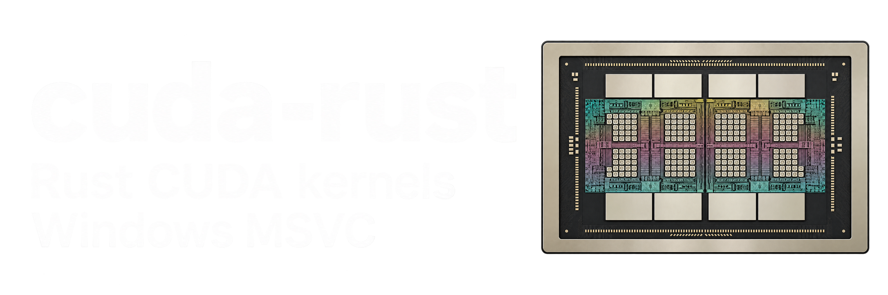

# CUDA Rust Windows

<p align="center">
  <a href="https://github.com/ansidium/cuda-rust-windows/actions/workflows/ci-status.yml"></a>
  <a href="https://github.com/ansidium/cuda-rust-windows/actions/workflows/windows.yml"></a>
  <a href="https://ansidium.github.io/cuda-rust-windows/"></a>
  <br><br>
  
</p>

Windows-support fork of [NVIDIA/cuda-rust](https://github.com/NVIDIA/cuda-rust).
Windows support targets `x86_64-pc-windows-msvc`.
The fork uses the latest stable Rust with compiler-internal APIs enabled by
the repository configuration.

| Platform | Setup |
| --- | --- |
| Windows 10/11 x64, MSVC | [Windows setup](cuda-oxide/cuda-oxide-book/getting-started/windows.md) |
| Linux | [SIMT setup](cuda-oxide/README.md#setup) or [Tile setup](cutile-rs/README.md) |

See [FORK.md](FORK.md) for fork differences and maintenance policy.

CUDA Rust is NVIDIA's CUDA platform for Rust. It provides
host-side crates for working with the CUDA driver and device-side crates and
tools for writing GPU kernels in idiomatic Rust.

* [cuda-oxide](./cuda-oxide) ([book](./cuda-oxide/cuda-oxide-book)): A custom rustc
  codegen backend, cargo helper utility, and crates to help users target the
  traditional CUDA **SIMT** (Single Instruction, Multiple Threads) kernel
  programming model. Here users have access to every
  detail of device-side CUDA programming.
* [cutile-rs](./cutile-rs) ([book](./cutile-rs/cutile-book)): A proc-macro plugin
  and crates to help users write CUDA kernels using the CUDA **Tile**
  programming model. Tensors are views into device memory, partitioned into
  sub-tensors; a kernel loads tiles from them, computes on
  whole tiles at a time, and stores tiles back, and the compiler decides how
  tiles map onto each architecture.
* Runtime: [`cuda-bindings`](./cuda-bindings), [`cuda-core`](./cuda-core)
  (with [`cuda-core-derive`](./cuda-core-derive)), and [`cuda-async`](./cuda-async)
  provide a shared runtime: driver bindings, contexts, streams, device buffers,
  events, and lazy, composable device operations.

Both kernel programming models extend Rust's ownership rules across the GPU
launch boundary: mutable buffers are partitioned into disjoint pieces before
launch, immutable buffers are shared, and launchers keep those borrows alive
while GPU work is in flight.

CUDA Rust is an early-stage research project. Expect bugs, incomplete features,
and API changes.

## Picking a model

|  | cuda-oxide (SIMT) | cutile-rs (Tile) |
| --- | --- | --- |
| Feels familiar to | CUDA C++ programmers: threads, blocks, shared memory | NumPy or PyTorch programmers: ndarray / tensor operations on multi-dimensional tiles |
| Safety | Data-race freedom for disjoint slice accesses; you control thread synchronization and shared memory | Data-race freedom by construction within a kernel: no explicit thread indexing, shared memory, or synchronization |
| Indexing | Explicit thread/block indices | Implicit via partitions |
| Compiles | Ahead of time, Rust → PTX | JIT at first launch, Rust → Tile IR → cubin |
| Toolchain | Latest stable Rust in this fork, managed by `cargo oxide` | Stable Rust |
| Portability | Produces PTX that the driver compiles for compatible GPUs; you control tuning per GPU | CUDA architecture-agnostic; the compiler tunes per GPU |
| Reach for it when | You need direct control over threads, warps, shared memory, TMA, or cluster ops | Your problem is naturally expressed as tensor computations and you want the compiler to handle scheduling details |

Choose between Tile and SIMT based on [each kernel's requirements](https://docs.nvidia.com/cuda/cuda-programming-guide/01-introduction/programming-model.html#relationship-to-simt-programming).
Tile can simplify development when its abstractions fit the workload, while SIMT
provides direct control over individual threads. An application can use both.

Here are some recommendations that may evolve as CUDA Rust matures:

* If you have familiarity with CUDA programming, then SIMT will feel comfortable to you.
* If your problem domain primarily involves math over densely packed numerical data, then Tile is a good fit.
* If your problem domain is sparse, involves pointer chasing, mapping traditional data structures to the GPU, or otherwise similar, then SIMT will give you more flexibility.
* CuTe abstractions on top of SIMT can be useful for workloads that need explicit performance tuning.

Kernels from both models interoperate: a cutile-rs Tile kernel and a cuda-oxide SIMT
kernel can run on the same stream over shared device buffers.

## Repository layout

```
cuda-rust-windows/
├── cuda-bindings/      runtime — CUDA driver API bindings
├── cuda-core/          runtime — contexts, streams, memory, modules, events, launch
├── cuda-core-derive/   runtime — derive macros for cuda-core
├── cuda-async/         runtime — lazy ops, futures, streams, graphs
├── cuda-oxide/         SIMT model — compiler, device crates, cuda-oxide-book
└── cutile-rs/          Tile model — compiler, tile crates, cutile-book
```

## Documentation

Start with the [fork documentation](https://ansidium.github.io/cuda-rust-windows/)
or the [upstream CUDA Rust docs](https://nvidia.github.io/cuda-rust/). cutile-rs
and cuda-oxide each have a book with installation instructions, guides, and
reference material. The runtime crates (cuda-bindings, cuda-core, cuda-async)
are documented in the cutile-rs book.

## Contributing

See [CONTRIBUTING.md](CONTRIBUTING.md) for commit sign-off requirements,
pull requests, and CI. Both models use stable Rust in this fork; cuda-oxide
also requires `rustc-dev`, `rust-src`, and `llvm-tools`.

## License

CUDA Rust is licensed under the [Apache License 2.0](./LICENSE). The root
`LICENSE` covers the whole repository: cuda-oxide, cutile-rs, and the shared
host crates. Every published crate declares `license = "Apache-2.0"`.

Third-party attributions are listed in
[`cuda-oxide/THIRD_PARTY_NOTICES`](./cuda-oxide/THIRD_PARTY_NOTICES).
