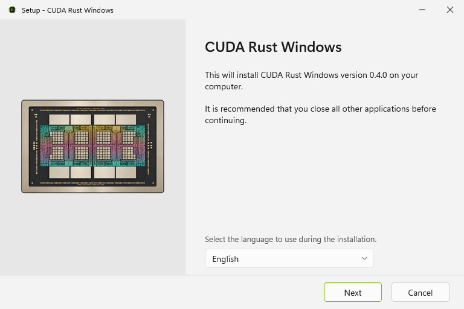
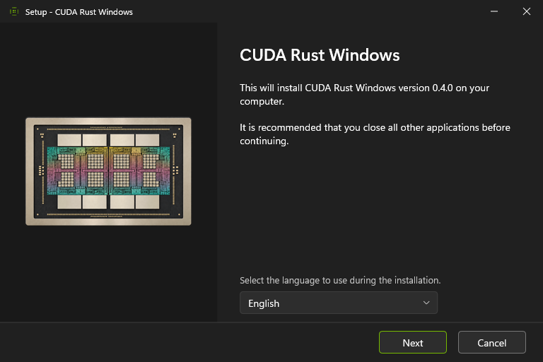
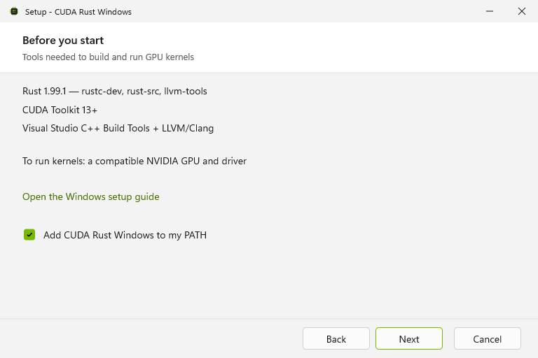

# CUDA Rust Windows 0.4.0

This Windows distribution adds a signed installer and a ready-built compiler
backend to cuda-oxide 0.4.0, with installation, updates and diagnostics for Windows
x64. It includes the merged upstream Windows work in
[PR #1770](https://github.com/NVIDIA/cuda-rust/pull/1770).

## What's included

- Signed onni installer with 24 interface languages, automatic light/dark themes,
  an optional user PATH entry, a developer shell shortcut and Windows Installed
  apps integration.
- Prebuilt backend checked against a signed manifest, the project's runtime
  revision and the full Rust compiler fingerprint. Other runtime revisions use
  their own source; `CUDA_OXIDE_PREBUILT=0` selects source builds explicitly.
- `cargo oxide windows update` and `cargo oxide windows rollback`. Rollback opens
  the previously installed version's installer, when one has been recorded.
- Backend-aware `doctor` diagnostics, bounded downloads and ZIP extraction, and
  PATH ownership preserved through repair and uninstallation.
- A portable ZIP with the same signed tools, file hashes and dependency notices.

## Get started

Download **cuda-oxide-v0.4.0-windows-x64-setup.exe**, install it, then open the
**CUDA Rust developer shell** from the Start menu:

```powershell
cargo oxide new my-kernel
cd my-kernel
cargo oxide doctor
cargo oxide run
```

Windows 10 22H2 or Windows 11 x64 is required. Rust 1.99.1 with compiler components,
CUDA Toolkit 13+, MSVC Build Tools and LLVM/libclang are installed separately.
See the [Windows setup guide](https://github.com/ansidium/cuda-rust-windows/blob/windows-v0.4.0/cuda-oxide/cuda-oxide-book/getting-started/windows.md).

The portable alternative is **cuda-oxide-v0.4.0-x86_64-pc-windows-msvc.zip**.
Extract all files together and keep projects outside that directory. SHA-256
checksum files accompany both downloads.

## Validation

The signed package compiled and ran the scaffolded GPU kernel on an NVIDIA
GeForce RTX 4080 with CUDA 13.4: all 1,024 results matched. CLI tests, clippy,
Windows PowerShell 5.1 release tests, five dependency graphs and the selected
source guards passed. Package tests include changed files, missing manifests,
wrong Rust/runtime identities and source-only selection.

Installation, developer-shell startup, repair and uninstallation were exercised
with the signed installer. Uninstallation restored the original user PATH and
kept the test project outside the install directory intact.

## Installer preview






